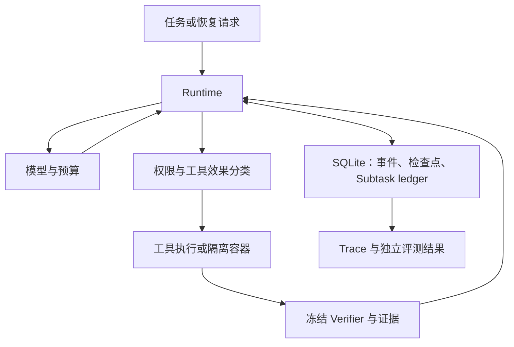

# Coding Agent Runtime 技术说明 — 2026-11-01

这个项目解决长程编码任务在中断、工具副作用不确定、文件变化和多执行者竞争下的恢复问题。
核心是本地 SQLite 状态机与证据约束；评测系统把机制正确性、候选修复与官方结果分别记录。
教学脚本与 Runtime 是独立代码，Runtime 不从 `agents/` 或教学目录导入实现。

## 运行链路

| 问题 | 实现位置与行为 | 工程边界 |
| --- | --- | --- |
| 进程中断 | `runtime.py` 和 `store.py` 保存执行检查点、模型/工具调用记录与恢复状态 | 依赖持久化边界，不能用“进程没报错”代替完成证据 |
| 子任务完成状态漂移 | Verifier 通过后，将 verified-subtask checkpoint、证据与执行检查点关联提交 | 状态权威来自冻结 Verifier；模型的完成文字只是触发信号 |
| 文件写入冲突 | read-before-edit、完整内容哈希前置条件、唯一文本替换 | 哈希前置条件不能 fence 任意并发外部写入者 |
| 工具效果不确定 | 区分 read_only、file_write、unknown_write 等；容器编辑按 unknown_write 处理 | 交付不确定时进入 review，不能自动重放来追求表面成功 |
| 旧执行者继续写入 | repository lease 和 fencing token 约束状态更新及效果边界 | 本地单仓库协议，没有通用分布式 exactly-once 保证 |
| 长程上下文 | 可查询 Subtask ledger、依赖快照和 scoped resume；相关机制有独立历史验证范围 | 不等于所有任务上的 token/成本收益已经证实 |
| 模型调用成本 | `inspect_model_eval.py` 固定模型、请求次数、输出 token、超时和重试边界 | 当前本轮入口使用 mock；付费调用未运行 |

## SWE 评测如何分层

| 层次 | 主要模块 | 得到什么证据 | 不能直接推导什么 |
| --- | --- | --- | --- |
| Runtime 机制 | 固定任务、故障注入、Store invariants、Trace | 某个冻结版本在明确场景下的恢复/安全行为 | 任意真实任务都正确 |
| 离线组合 | `evaluation_suite.py`、Inspect mock、`evaluation_report.py` | 数据与日志对账、重复证据复用、受控调用链 | 真实 Docker 或自主编码成功 |
| 单实例候选 | `inspect_swe_runner.py`、`container_edits.py`、`swe_environment.py` | 题目/基础提交绑定、候选 patch 与冻结 probes | SWE 官方 resolved |
| 官方评分 | `swe_grading.py` | 固定 Harness、完整预测分母、schema-v2 report 的一致性校验 | 缺失或执行错误实例已成功 |

数据集准备将 `problem_statement/repo/base_commit/instance_id` 放入 solver 输入，
gold patch、test patch 与官方用例留在 evaluator 一侧。模型能力只能通过实际独立任务结果评估，
不能用模拟 edit 通过或候选探针通过代替。

候选导出核对 workspace、instance、base、revision、validator、patch SHA-256、可应用性及 probe 结果。
官方层核对 Harness commit、运行退出码、report 身份、ID 分区、数量和空补丁成员。
失败实例保留空预测；缺失/执行错误的官方结果保留 unknown。

## 可以用于面试的简短表达

“我实现了一个本地持久化 Coding Agent Runtime。执行状态和工具调用进入 SQLite，
子任务通过冻结 Verifier 后再形成带证据的检查点。恢复时根据工具效果类型处理，
对不确定写入保留人工复核，结合文件哈希前置条件和 lease/fencing 避免不安全重放。
评测方面接入 Inspect，并把 Runtime 机制检查、候选验证与 SWE 官方评分分开；
当前新增 SWE 链路有离线组合证据，真实 Docker 和官方评分仍需完成验收。”

继续追问时可以用三个例子展开：

1. 工具实际执行后、结果入库前崩溃：先判断效果语义与已有记录，不能对未知外部写入盲目重放。
2. 读取后文件被改：编辑携带旧内容哈希，失败后重新观察；不会把旧证据当成当前状态。
3. 候选测试通过但官方评分未执行：只记录 candidate_validated，official_resolved 保持 null。

## 当前版本与证据

活动 worktree 的本地 HEAD 仍为 `c3e1192`，后续实现包含未提交改动。
本地发布回执记录 2026-10-25 候选 HEAD `4b872495...`、Linux 增量 55 项通过；
这不是当前远端状态查询，也不能覆盖后续本地代码。

2026-11-01 代码审查的 61 项受影响检查通过（16 新回归，45 受影响既有检查），
修复脚本预检、归档大小限制和 CI 遗漏。后续工具另有增量验证，
详见 [可做事项收口记录](offline-followthrough-20261101.md) 的实际结果与证据路径。
各批次按各自源码范围解释，不把历史通过数累加成“当前全量测试数”。

本轮没有真实 Docker、付费模型、官方 Harness、旧实验复跑、发布或主线合并。
剩余最关键证据是：明确 Engine 上的真实单实例生命周期、候选验证、清理与固定官方评分。

操作说明见 [普通用户入口与准备方案](swe-operator-guide-20261101.md)，
代码审查见 [未发布代码审查](unpublished-review-20261101.md)。
